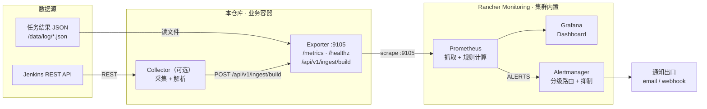
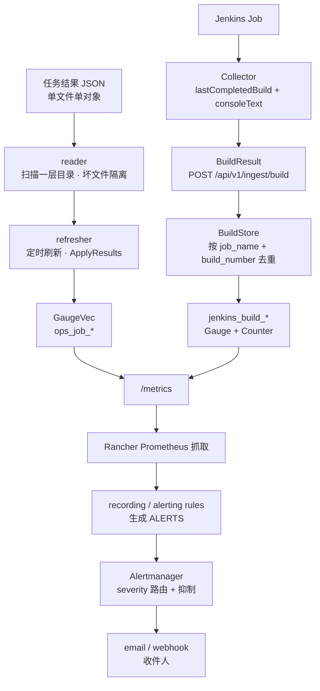

# Ops Exporter

把**定时任务的执行结果**和 **Jenkins 构建结果**统一为 Prometheus 指标，交给 Rancher 内置的 Prometheus / Grafana / Alertmanager 做展示和告警。

单一 Go module（`ops-exporter`），两个独立入口，边界隔离：

- **Exporter**（`:9105`）：读取任务结果 JSON，接收 Collector 推送，暴露 `/metrics`、`/healthz`。
- **Collector**（可选）：定时拉取 Jenkins REST API，把构建结果推送给 Exporter。

本仓库**不部署 Prometheus / Grafana / Alertmanager**，也不含自建通知服务；告警通知由 Rancher 内置 Alertmanager 的原生 receiver（email / webhook）完成。

## 架构



边界约定：两个 `internal/*` 子树互不 import；`BuildResult` 在两侧为契约镜像（字段与 JSON 一致，但不共用包，改字段须同步两边）。

## 数据流向



关键机制：幂等去重、断点续传（`state.json`）、心跳重发（重启后恢复 Gauge）、数据过期（`max_build_age` 只删 Gauge 保留 Counter）。详见 `docs/ARCHITECTURE.md`。

## 快速开始

```bash
docker compose up -d                          # 只起 Exporter
docker compose --profile collector up -d      # 需要 Jenkins 采集时（先填 .env）
curl -s localhost:9105/healthz
curl -s localhost:9105/metrics | grep -E '^ops_job_|^jenkins_build_'
```

完整部署、配置与本地开发步骤见 `docs/QUICKSTART.md` 和 `DEPLOY.md`。

## 文档

| 文档 | 内容 |
|---|---|
| `docs/ARCHITECTURE.md` | 目录结构、核心机制、边界约定、指标清单 |
| `docs/QUICKSTART.md` | 容器启动、本地开发验证、配置文件说明 |
| `DEPLOY.md` | Linux/systemd、Rancher 抓目标、Dashboard 导入、故障排查 |
| `ALERTING_SETUP.md` | Helm values 层级、告警规则、Alertmanager 路由、webhook 测试 |
| `promql.md` | 查询语句、告警表达式、No data / 从未成功语义 |
| `PROJECT_SUMMARY.md` | 项目现状、收尾验证清单、升级路线与维护原则 |
| `docs/task1-architecture.md` | 动态化改造的架构分析与设计演进（历史文档） |


